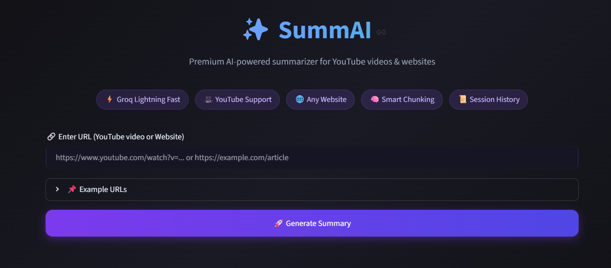

# ✨ SummAI — Premium Content Summarizer

A beautiful, production-ready Streamlit app that summarizes **YouTube videos** and **any website** using Groq's ultra-fast open-source LLMs + LangChain.


---



## ✨ Features

- 🎥 **YouTube Support** — Extracts transcripts automatically
- 🌐 **Website Summarization** — Works with almost any public URL
- ⚡ **Groq Powered** — Llama 3.3 70B, Llama 3.1 8B, Gemma 2, GPT-OSS
- 🧠 **Smart Chunking** — Handles long articles & videos with map-reduce
- 🎨 **Premium Dark UI** — Modern glassmorphism design
- 📥 **Download Summary** — One-click .txt download
- 🎛️ **Customizable** — Choose model + summary length

---

## 🚀 Quick Deploy on Streamlit Cloud

1. Push this folder to a GitHub repository
2. Go to [share.streamlit.io](https://share.streamlit.io)
3. Connect your repo → select `app.py`
4. Add your **Groq API Key** as a secret (optional) or let users enter it
5. Deploy!

---

## 🖥️ Local Run

```bash
# Clone / download the project
cd premium_summarizer

# Install dependencies
pip install -r requirements.txt

# Run the app
streamlit run app.py
```

---

## 🔑 Get Free Groq API Key

1. Visit [console.groq.com](https://console.groq.com)
2. Sign up / Login
3. Create an API key
4. Paste it in the sidebar of the app

---

## 📁 Project Structure

```
premium_summarizer/
├── app.py                 # Main Streamlit application
├── requirements.txt       # Dependencies
├── .streamlit/
│   └── config.toml        # Dark theme configuration
└── README.md
```

---

## 🛠️ Tech Stack

| Component       | Technology                  |
|----------------|-----------------------------|
| Frontend       | Streamlit + Custom CSS      |
| LLM Backend    | Groq (Llama / Gemma)        |
| Orchestration  | LangChain                   |
| Loaders        | YoutubeLoader + UnstructuredURLLoader |
| Text Splitting | RecursiveCharacterTextSplitter |

---

## 📝 Notes

- YouTube videos **with captions/transcripts** work best
- Some websites may block scraping — try different URLs
- Free Groq tier is very generous for personal use

---

**Made with ❤️ for the community**
